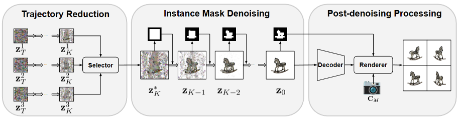
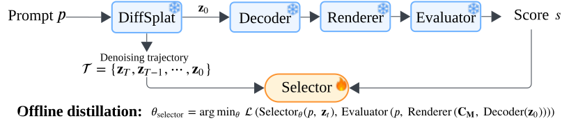

# TRIM: Scalable 3D Gaussian Diffusion Inference with Temporal and Spatial Trimming

> [NeurIPS 2025](https://arxiv.org/abs/2511.16642) \
> [Zeyuan Yin](https://zeyuanyin.github.io/), [Xiaoming Liu](http://www.cse.msu.edu/~liuxm/) \
> Computer Vision Lab, Michigan State University

---



We propose **TRIM** (**T**rajectory **R**eduction and **I**nstance **M**ask denoising), a
post-training approach that incorporates both temporal and spatial trimming strategies, to
accelerate inference without compromising output quality while supporting the inference-time
scaling for 3D Gaussian diffusion models.

## Installation

```bash
conda create -n trim python=3.12 -y
conda activate trim
bash setup.sh
```

TRIM builds on the pretrained [DiffSplat](https://github.com/chenguolin/DiffSplat/)
checkpoints (using [SD3.5-Medium](https://huggingface.co/stabilityai/stable-diffusion-3.5-medium)).
Download these first before running any of the commands below.

## Instructions

Given N sampled noises, TRIM denoises all N candidates to an intermediate timestep t, uses a
trained latent selector to keep only the most promising one via pairwise tournament
selection, early-terminates denoising for the rest, and finishes denoising only that one
trajectory to completion, cutting both denoising and post-denoising (VAE decode + Gaussian
splat render) cost by ~N times.



### 1. Data synthesis

Following Algorithm 1 in the paper, we use ChatGPT-4o to generate `N=100` prompts
([`4o_single_object_prompts_100_in1000.txt`](data/prompts/4o_single_object_prompts_100_in1000.txt)) and
synthesize `M=64` denoising trajectories per prompt (20 steps each), saving the per-step
Gaussian latents that are later used to train the selector:

```python
import os

for seed in range(64):
    os.system(
        "python3 -m src.infer_gsdiff_sd3 "
        "--config_file configs/gsdiff_sd35m_80g.yaml --tag gsdiff_gobj83k_sd35m__render "
        "--allow_tf32 --triangle_cfg_scaling --save_trajectory --name_by_id "
        "--prompt_file data/prompts/4o_single_object_prompts_100_in1000.txt "
        f"--output_dir data/trajectories/steps20_seed{seed} "
        f"--guidance_scale 7 --num_inference_steps 20 --seed {seed}"
    )
```

The trajectory information is stored in a tensor with the size of
`(100, 64, 4, 16, 32, 32)`, covering 100 prompts x 64 seed trajectories, each entry being the
Gaussian latent at one denoising step (4 views x 16 channels x 32x32). One such tensor is
provided per step, `data/trajectory_latent_data/latent_data_4o_data100_seed64_step{k}in20.pt`
for `k = 0...19`, so the selector can be trained at any denoising progress. These tensors are
uploaded to [HuggingFace](https://huggingface.co/datasets/zeyuanyin/TRIM).

### 2. Scoring

Each seed's renders are then scored with CLIP similarity and ImageReward, run once per seed:

```bash
python3 -m src.run_score \
  --inference_dir data/trajectories/steps20_seed0/gsdiff_gobj83k_sd35m__render/inference \
  --prompt_file data/prompts/4o_single_object_prompts_100_in1000.txt \
  --output_dir data/trajectory_latent_data/score_results_4o/sd3_num_inference_steps_20_seed_0
```

The resulting scores already ship under `data/trajectory_latent_data/score_results_4o/`,
paired with the cached latents above, and are uploaded to [HuggingFace](https://huggingface.co/datasets/zeyuanyin/TRIM).

### 3. Selector training

The selector is trained on latents taken at step 9 of 20 (~50% denoising progress), matching
the paper's default trajectory-reduction timestep t = T/2 (Sec. 3.2, "Temporal Trimming
Scheme"):

```bash
python3 -m src.train_selector --step_idx 9 --total_steps 20
```

Since `data/trajectory_latent_data/` already ships the cached latents and scores, this step
can be run directly without steps 1-2. The trained selector
([`src/selector/model.py`](src/selector/model.py): `LatentSelector`, Conv1-FC2 by default) is
saved to `checkpoints/selector_{step_idx}in{total_steps}/selector.pt`, e.g.
`checkpoints/selector_9in20/selector.pt` for the default config, which is also the path the
next step reads from by default. We provide our trained selector in
[`checkpoints/selector_9in20/selector.pt`](checkpoints/selector_9in20/selector.pt).

### 4. Generation

Text-to-3D and image-to-3D generation each use their own pretrained tag on the same SD3.5
backbone:

```bash
python3 -m src.infer_gsdiff_sd3 \
  --config_file configs/gsdiff_sd35m_80g.yaml --tag gsdiff_gobj83k_sd35m__render \
  --prompt "a red toy robot" --guidance_scale 7 --triangle_cfg_scaling
```

```bash
python3 -m src.infer_gsdiff_sd3 \
  --config_file configs/gsdiff_sd35m_80g.yaml --tag gsdiff_gobj83k_sd35m_image__render \
  --image_path assets/examples/1_wukong_avatar.png --guidance_scale 2 --triangle_cfg_scaling
```

Repeating this command with different `--seed` values produces exactly the kind of candidate
trajectories the selector chooses among; Section 5 measures the resulting quality gain.

### 5. Evaluation

Building on the generation command above, this script reproduces the trajectory-reduction
hit-rate / CLIP-similarity / ImageReward improvement (Table 5, Fig. 8a) by simulating
tournament selection over pre-generated trajectories:

```bash
python3 -m src.eval_trajectory_reduction --num_candidates 8 --num_repeats 32
```

Here, `--num_candidates` is N, the number of sampled noises/trajectories per prompt that TRIM
selects among (the inference-time scaling factor in Fig. 6/8); `--num_repeats` resamples a
different random N-of-64 subset this many times so the reported mean/std matches the
repeated-trial protocol used in Table 5.

Evaluation data:

- **Text-to-3D**: the T3 Bench prompts in [`data/prompts`](data/prompts),
  [`t3bench_single.txt`](data/prompts/t3bench_single.txt),
  [`t3bench_surr.txt`](data/prompts/t3bench_surr.txt) and
  [`t3bench_multi.txt`](data/prompts/t3bench_multi.txt).
- **Image-to-3D**: the 300 Google Scanned Objects listed in
  [`data/gso/gso_data_300.txt`](data/gso/gso_data_300.txt) (Table 2), also provided as
  [`gso_data_300.json`](data/gso/gso_data_300.json). Download the dataset with
  [`data/gso/download_gso.sh`](data/gso/download_gso.sh) and select the listed objects.

## Acknowledgement
This repository is built on top of [DiffSplat](https://github.com/chenguolin/DiffSplat/).

## Citation
If you find this repository helpful, please consider citing:
```bibtex
@inproceedings{
    Yin2025TRIM,
    title={{TRIM}: Scalable 3D Gaussian Diffusion Inference with Temporal and Spatial Trimming},
    author={Yin, Zeyuan and Liu, Xiaoming},
    booktitle={The Thirty-ninth Annual Conference on Neural Information Processing Systems (NeurIPS)},
    year={2025}
}
```
